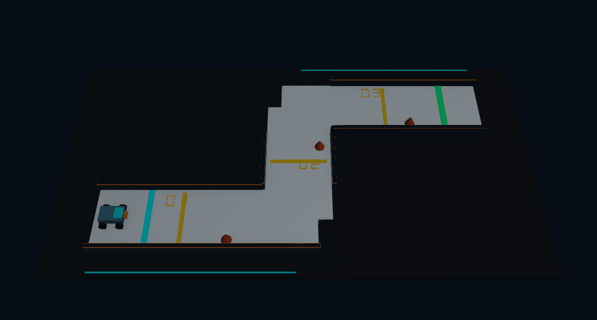

# Ověření opraveného projektu

Tento protokol zachycuje ověření původních tří úrovní. Úroveň 4 a nové rozmístění překážek byly přidány později a v tomto protokolu nejsou fyzikálně ověřené.

Datum: 11. 10. 2026. Prostředí: Windows, Webots R2025a; základní konfigurace `junior-track-v2-level-1`.

## Opravy

- Kamera nyní míří na střed arény a zabírá celou trať. Panel nabízí tlačítko **Zobrazit dráhu**, které obnoví tento pohled.
- Válce kol jsou otočené ze své lokální osy Z na nápravu Y. Kladná rychlost motorů kolem +Y pohání auto vpřed po +X. Kužely stojí s osou Z svisle.
- Osvětlení je zesílené a výchozí program je kalibrovaný skutečnými jízdami.
- WWI JSON používá Unicode escape sekvence: Python binding R2025a počítá v `wwiSendText` délku znaků místo bajtů, což dříve zkracovalo zprávy s českými texty.
- Panel po otevření explicitně žádá aktuální stav pomocí `hello`; po ztrátě spojení se připojí znovu a získá poslední výsledek. Webots zpracovává `init robot window` sám.
- Výběr obtížnosti přepíná tři fyzické trasy. Úroveň 2 přidává dvě vlny; úroveň 3 přidává čtyři vlny, slalomovou část a čtyři bariéry. Každá úroveň používá vlastní konfiguraci a žebříček.

## Skutečný snímek scény

Tento snímek exportoval Webots Supervisor z vykresleného testovacího světa po ustálení fyziky. Nejde o ilustraci ani náhradní náhled.



## Výsledky

| Kontrola | Výsledek |
|---|---|
| Logické Python testy | 22/22 prošlo |
| Fyzikální integrační případy | 21/21 prošlo |
| Pohyb vpřed a vzad | Ověřený skutečnou změnou polohy |
| Levý a pravý yaw vpřed i vzad | Ověřený orientací robota |
| Kontakt s kuželem | Společné fyzikální kontaktní body auta a kužele; právě jedna penalizace +2 s |
| Vyjetí mimo koridor | DNF a reset |
| Výchozí program | 10/10 platných dokončení, všechny tři checkpointy, žádné penalizace |
| Čas ukázky | Všech 10 jízd: 20,368 s; pozorovaný rozptyl 0,000 s |
| Ukázka úrovně 2 | Dokončení za 20,384 s bez penalizací |
| Ukázka úrovně 3 | Dokončení za 21,264 s bez penalizací |
| Reset | Přesná startovní poloha po každém testovacím případě |
| Testovací režim | Žebříček zůstal prázdný |
| Oficiální režim | Platný výsledek uložen a znovu načten z JSON v odděleném testovacím projektu |
| Produkční WWI klient | Přepnutí všech tří úrovní, validace, obnovení kamery, jízda do cíle, opětovné spojení, obnovení výsledku a reset prošly |

Stručná strojově čitelná data jsou v [webots-results.json](webots-results.json). Úplné stopy opakovací test generuje do `tests/webots/reports/integration.json`. Pozorovaný nulový rozptyl platí pro tento měřený běh a konfiguraci; změna fyziky vyžaduje novou kalibraci.

## Opakování kontrol

```powershell
python -m unittest discover -s tests -v
python tests/run_webots_integration.py
```

Otevřete hlavní svět, spusťte simulaci a proti jeho portu proveďte také:

```powershell
node tests/robot_window_smoke.mjs 1234
```

Fyzikální runner používá oddělený testovací svět a žebříček. WWI kontrola používá skutečný klientský JavaScript bez prohlížeče, takže neposuzuje grafické rozložení HTML. Snímkem byl ověřen 3D pohled, nikoli klikání v nativním okně Webots.

## Použité konvence Webots

- [Viewpoint v R2025a: výchozí směr +X](https://github.com/cyberbotics/webots/blob/R2025a/src/webots/nodes/WbViewpoint.cpp#L1136)
- [Cylinder: lokální osa Z](https://github.com/cyberbotics/webots/blob/R2025a/docs/reference/cylinder.md)
- [Oficiální WWI RobotWindow klient](https://github.com/cyberbotics/webots/blob/R2025a/resources/web/wwi/RobotWindow.js)
